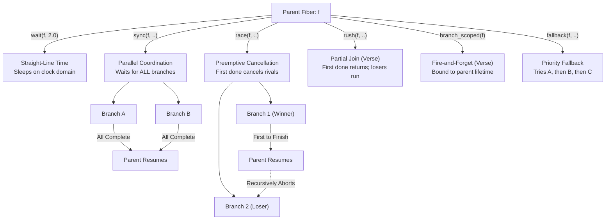

# Stackful Coroutines with Structured Concurrency in Odin

> **Compiler Requirement**: Built and verified with Odin `dev-2026-10` (`master` branch commit [`151d53f44`](https://github.com/odin-lang/Odin/commit/151d53f44)).

A high-performance, deterministic **stackful coroutine engine** with **structured concurrency** for [Odin](https://odin-lang.org/), context switching via native inline assembly [`asm`](https://odin-lang.org/docs/inline-asm/).

Inspired by Epic’s **Verse** and **SkookumScript**, this library lets you write complex gameplay logic—combat abilities, multi-phase boss fights, dialogues, cutscenes, and AI decision trees—as clean, sequential, straight-line code. No callback spaghetti, no state-machine boilerplate, no manual delta-time accumulators.

---

## The Verse & SkookumScript Mental Model

Traditional game code often drowns in state machine flags, timer accumulators, and fragile `switch (state)` blocks across hundreds of frames. 

With structured coroutines, time flows naturally in straight-line code while the runtime handles suspension, parallel execution, timeouts, and hierarchical cancellation:



---

## Structured Concurrency in Action

### 1. Straight-Line Timing (`wait`, `yield`, `yield_now`)

Write timed abilities and multi-step actions without timer variables or delta-time bookkeeping:

```odin
// 3-step attack sequence with natural frame & second delays
fireball_combo :: proc(f: ^coroutine.Fiber, caster: ^Hero) {
    play_animation(caster, .Cast_Startup)
    coroutine.wait(f, 0.4) // Wait 400ms for startup windup

    spawn_projectile(caster.pos, caster.facing)
    play_sound(.Fireball_Launch)
    coroutine.wait(f, 0.2) // Recovery delay

    coroutine.yield_now(f) // Cooperative timeslice share in same frame (Verse Sleep(0.0))
    coroutine.yield(f)     // Pause for exactly 1 game tick before idle
    play_animation(caster, .Idle)
}
```

> [!TIP]
> **`yield(f)` vs `yield_now(f)`**: Use `yield(f)` (or `wait(f, dt)`) when waiting for game state that updates across frame boundaries. Use `yield_now(f)` (Verse `Sleep(0.0)`) solely to distribute heavy CPU computation across fibers in the current frame without spinning.

### 2. Parallel Coordination (`sync`)

*Verse `sync` / SkookumScript `sync()`*: Runs multiple branches concurrently and suspends the parent fiber until **all** branches finish:

```odin
// Open an ancient temple gate only when all 3 ritual runes are fully energized
coroutine.sync(f,
    coroutine.branch(charge_rune, &rune_fire),
    coroutine.branch(charge_rune, &rune_ice),
    coroutine.branch(charge_rune, &rune_lightning),
)

open_temple_gate()
play_sound(.Gate_Unlocked)
```

### 3. Preemptive Competition (`race`)

*Verse `race` / SkookumScript `race()`*: Runs multiple branches concurrently in competition. The instant **any branch succeeds** (`.Completed`), it wins the race and all other competing branches are immediately and recursively aborted. Branches that call `coroutine.fail(f)` drop out without winning; if all branches fail, `race` returns `-1`:

```odin
// Boss charges a devastating mega laser, but player can interrupt it with an EMP stun!
winner := coroutine.race(f,
    coroutine.branch(boss_mega_laser_charge, boss),
    coroutine.branch(proc(f: ^coroutine.Fiber, sig: ^coroutine.Signal) {
        coroutine.signal_wait(f, sig)
    }, &boss.stun_signal),
)

if winner == 1 {
    // Stun signal finished first! The laser attack was cleanly cancelled.
    play_sound(.Boss_Stunned)
    coroutine.wait(f, 2.0) // Boss staggered for 2 seconds
}
```

### 4. Non-Cancelling Partial Join (`rush`)

*Verse `rush`*: Runs arms concurrently. Completes as soon as the **first** branch finishes, but **does not cancel losing branches**—allowing them to continue executing in the background:

```odin
// Continue immediately when the fast low-res mesh loads, but let high-res keep streaming:
coroutine.rush(f,
    coroutine.branch(load_low_res_mesh, asset),
    coroutine.branch(load_high_res_mesh, asset),
)
// Low-res finished -> gameplay resumes immediately! High-res continues in background.
```

### 5. Scope-Bound Fire-and-Forget (`branch_scoped`)

*Verse `branch:`*: Spawns a concurrent child task that runs in the background while the parent continues immediately. If the parent finishes or is cancelled, the background task is automatically aborted:

```odin
// Inside an ability fiber: fire-and-forget secondary particle FX & camera shake
coroutine.branch_scoped(f, play_flame_emitter, &player.pos)
coroutine.branch_scoped(f, camera_shake_loop, 0.5)

// Parent continues immediately! If ability exits or player dies, children are auto-aborted.
```

### 6. Priority Fallback (`fallback`)

Executes branches sequentially ($A \rightarrow B \rightarrow C$). If an action calls `coroutine.fail(f)`, the engine automatically rolls over to the next candidate:

```odin
// Combat AI decision tree: Melee -> Ranged -> Retreat
ok, idx := coroutine.fallback(f,
    coroutine.branch(try_melee_strike, monster),
    coroutine.branch(try_ranged_shoot, monster),
    coroutine.branch(flee_to_safety, monster),
)
```

### 7. Automatic Timeouts (`with_timeout`)

Wraps any task in a deadline. If it doesn't complete in time, it is aborted cleanly:

```odin
// Player has 5.0 seconds to defuse the bomb before detonation
defused := coroutine.with_timeout(f, 5.0, coroutine.branch(defuse_bomb_loop, &bomb))
if !defused {
    detonate_bomb(&bomb)
}
```

### 8. Latched State Events (`Sticky_Event` & `Sticky_Signal`)

*Verse `sticky_event`*: Broadcasts state transitions where late-joining fibers immediately receive the cached value without deadlocking:

```odin
match_started: coroutine.Sticky_Signal

// Emitted once during level transition:
coroutine.sticky_signal_emit(&sched, &match_started)

// Any coroutine starting later receives it immediately without suspending:
coroutine.sticky_signal_wait(f, &match_started) // Instant return!
```

### 9. Broadcast Signals & Multicast Events (`Signal` & `Event(T)`)

Zero-allocation, True-ZII signaling across fibers with 0 heap overhead:

```odin
// Broadcast alert signal
alert_beacon: coroutine.Signal

// Any number of guards can wait on the signal without allocating memory:
coroutine.spawn(&sched, proc(f: ^coroutine.Fiber, sig: ^coroutine.Signal) {
    coroutine.signal_wait(f, sig)
    attack_intruder()
}, &alert_beacon)

// Wake all listening guards simultaneously:
coroutine.signal_emit(&sched, &alert_beacon)

// Typed events carry payloads with the same unified engine:
death_event: coroutine.Event(Death_Info)
coroutine.event_emit(&sched, &death_event, Death_Info{victim_id = 42})
```

### 10. Entity Lifecycles & Hierarchical Scopes (`Fiber_Scope`)

Attach coroutines to entity scopes. When an entity despawns or changes state, cancel all its coroutines in $O(1)$ with no lingering callbacks or dangling pointers:

```odin
on_boss_death :: proc(sched: ^coroutine.Scheduler, boss: ^Boss) {
    // Instantly aborts all active attacks, lasers, telegraphs, and timers on this boss
    coroutine.scope_cancel(sched, &boss.scope)
    spawn_death_explosion(boss.pos)
}
```

---

## Interactive Demos

The repository includes complete, playable **Raylib** games:

| Demo | Focus & Subsystems | Primary Features | Run Command |
| :--- | :--- | :--- | :--- |
| **[2D Boss Encounter](examples/game)** | Gameplay & AI | Multi-phase combat, EMP parry stun, Matrix bullet-time slow-mo on RMB | `.\build.ps1 run` |
| **[All-Features Showcase](examples/showcase)** | Feature Sandbox | 7 stations: ritual `sync`, contest `race`, drone mutex, sentry signals | `.\build.ps1 run-showcase` |
| **[AI & Quest Sandbox](examples/quest_ai)** | Decision Trees | Tactical `rush`, fallback decision trees, hierarchical `Fiber_Scope` | `.\build.ps1 run-quest` |
| **[WebAssembly Game](build/web)** | Browser & Node.js | Pure Wasm Asyncify + Canvas 2D, 1,000-frame headless CI test | `.\build.ps1 test-web-game` |

1. **2D Boss Fight Demo (`examples/game`)**:
   - Multi-phase boss battle showcasing combat `race` vs. stun interruptions, spiral bullet patterns, and EMP parries.
   - **Matrix-Style Bullet-Time Slow-Mo**: Hold Right Mouse Button (RMB) to slow down the world while dodging bullets with enhanced agility, bounded by a regenerating recovery bar.
   - Live visual coroutine tree inspector overlay (`H` / `Tab`).
   - Run: `.\build.ps1 run`

2. **All-Features Showcase Game (`examples/showcase`)**:
   - 7 interactive stations: ritual circle `sync`, capture contest `race`, drone mutex charger, sentry broadcast signal, loot forge generator, async compute lab, and CSP telemetry stream.
   - Run: `.\build.ps1 run-showcase`

3. **WebAssembly Game Build (`build/web`)**:
   - Compiles to `js_wasm32` via Binaryen Asyncify with an HTML5 Canvas 2D adapter.
   - Automated 1,000-frame headless Node.js verification.
   - Run: `.\build.ps1 test-web-game`

---

## Minimal Quickstart

Get a coroutine scheduler up and running in under 20 lines of Odin:

```odin
package main

import "core:fmt"
import coroutine "path/to/coroutines_asm"

main :: proc() {
    sched: coroutine.Scheduler
    coroutine.scheduler_init(&sched)
    defer coroutine.scheduler_destroy(&sched)

    // Spawn a fiber
    coroutine.spawn(&sched, proc(f: ^coroutine.Fiber) {
        fmt.println("Coroutine started!")
        coroutine.wait(f, 1.0) // Sleep for 1.0 second
        fmt.println("1 second later, coroutine resumed!")
    })

    // Game loop simulation step
    for coroutine.scheduler_step(&sched, 0.016) {
        // Pump game engine / render frame...
    }
}
```

---

## Engine Architecture & Systems Foundation

Underneath the high-level Verse/SkookumScript API sits a zero-overhead systems kernel designed for real-time game engines:

- **Universal Multi-ISA Native Inline Assembly Context Switch**:
  - **AMD64 (x86-64)**: Fast register swap for Windows x64 (160B frame preserving `xmm6`..`xmm15`) and System V AMD64 (64B frame). Self-ID: `%r12`.
  - **ARM64 (AArch64)**: Native 160B AAPCS64 frame preserving `x19`..`x28`, `x29` (FP), `x30` (LR), and `d8`..`d15` on Apple Silicon (M1–M4), Linux ARM, iOS, Android, and Nintendo Switch. Self-ID: `%x19`.
  - **RISC-V 64 (RV64GC)**: Native 208B LP64D frame preserving `ra`, `s0`..`s11`, and `fs0`..`fs11` for open-source RISC-V hardware. Self-ID: `%s2`.
  - **WebAssembly (`js_wasm32`)**: Native browser and Node.js execution via Binaryen Asyncify with shadow-stack protection.
- **100% Zero Allocations During Gameplay (True ZII)**:
  - Primitives (`Signal`, `Event(T)`, `Wait_Queue`) use doubly-linked intrusive pointers embedded in `Fiber` (`next_waiter`, `prev_waiter`). Zero heap allocations, unbounded waiter capacity, $O(1)$ in-place node removals, and 100% Zero Is Initialization.
  - Generational 32-bit handles (`Fiber_Handle`) ensure $O(1)$ lookups with ABA safety.
  - 128-byte inline value payloads (`spawn_val` / `branch_val`) allow passing values without heap allocation.
- **Indexed Multi-Domain Engine Clocks (`Clock_Domain`)**:
  - `Scheduler` holds an indexed array of timeline domains (`clocks: [MAX_CLOCKS]Clock_Domain`).
  - Standard domains: `CLOCK_SIM` (pausable gameplay), `CLOCK_REAL` (unpausable UI/menus), and `CLOCK_PHYS` (fixed physics/logic ticks).
  - Child branches in `sync`/`race`/`rush` automatically inherit `parent.clock_id`.
  - Zero duplicate APIs: `wait(f, seconds)`, `wait_steps(f, steps)`, and `yield(f)` work transparently across whichever clock domain the fiber belongs to.

  ```mermaid
  flowchart LR
      Step["scheduler_step(sched, dt)"] --> Clocks

      subgraph Clocks["Clock Domains"]
          SIM["CLOCK_SIM<br/>Pausable World Sim"]
          REAL["CLOCK_REAL<br/>Unpausable Real-Time"]
          PHYS["CLOCK_PHYS<br/>Fixed Physics Steps"]
      end

      SIM --> F1["Boss Combat AI & Projectiles"]
      REAL --> F2["UI Menus & Matrix Slow-Mo Dash"]
      PHYS --> F3["Fixed Simulation Solvers"]
  ```
- **Per-Fiber Isolated Temporary Allocator**:
  - Embedded 4KB `mem.Arena` in each `Fiber` assigned to `context.temp_allocator`, guaranteeing allocations survive across yield points without cross-coroutine contamination.
- **Fiber-Owned Zero-Drift Tickers**:
  - Zero-drift timers stored directly inside `Fiber` (`ticker_wait(f, interval)`, `ticker_rebase(f)`), completely immune to WebAssembly Asyncify stack clobbering with no external struct allocations.
- **Multi-Tiered Stack Safety**:
  - Hardware guard pages (`PAGE_NOACCESS` on Windows, `PROT_NONE` on Linux/macOS).
  - Canary watermark (`0xDEAD_BEEF_CAFE_BABE`) with high-water stack profiling (`fiber_calc_stack_usage`).
- **Unopinionated Async Job Bridge (`await_async` / `Async_Token`)**:
  - Atomic-backed completion token allowing fibers to yield cleanly until background OS threads or worker pools finish. Zero scheduler-side condition polling.
- **Modular CSP & Concurrency Subpackage (`coroutine/sync`)**:
  - Dedicated optional subpackage providing Go/OS-style synchronization when needed:
    - `Channel(T)`: Unbuffered rendezvous and bounded FIFO buffered queues.
    - `chan_select_recv`: Multi-channel multiplexer.
    - `Fiber_Mutex`: Non-blocking cooperative mutual exclusion (`with_mutex`).
    - `Fiber_Semaphore`: Cooperative counting semaphore (`with_semaphore`).

---

## Target Architecture Support Matrix

| Target Architecture | ABI Standard | Frame Size | Preserved State | Self-Identity Register | Verification Status |
| :--- | :--- | :--- | :--- | :--- | :--- |
| **Windows x86-64 (AMD64)** | Microsoft x64 | 160 bytes | `rbp`, `rbx`, `rsi`, `rdi`, `r12`..`r15`, `xmm6`..`xmm15` | `%r12` | **182 / 182 Tests PASS (Native Host Windows)** |
| **Linux x86-64 (AMD64)** | System V AMD64 | 64 bytes | `rbp`, `rbx`, `rsi`, `rdi`, `r12`..`r15` | `%r12` | **182 / 182 Tests PASS (Native WSL2 Host CPU)** |
| **Linux ARM64 (AArch64)** | AAPCS64 | 160 bytes | `x29` (FP), `x30` (LR), `x19`..`x28`, `d8`..`d15` | `%x19` | **182 / 182 Tests PASS (WSL2 QEMU)** |
| **Linux RISC-V 64 (RV64GC)** | LP64D | 208 bytes | `ra`, `s0`..`s11`, `fs0`..`fs11` | `%s2` | **182 / 182 Tests PASS (WSL2 QEMU)** |
| **macOS Apple Silicon (ARM64)** | AAPCS64 | 160 bytes | `x29` (FP), `x30` (LR), `x19`..`x28`, `d8`..`d15` | `%x19` | **182 / 182 Tests PASS (AAPCS64 ABI Verified)** |
| **macOS x86-64 (AMD64)** | System V AMD64 | 64 bytes | `rbp`, `rbx`, `rsi`, `rdi`, `r12`..`r15` | `%r12` | **182 / 182 Tests PASS (SysV AMD64 ABI Verified)** |
| **WebAssembly (`js_wasm32`)** | Wasm + Asyncify | Linear Memory | Shadow Stack Unwind/Rewind | N/A | **16 / 16 Test Suites + 1,000-Frame Headless Game PASS** |

---

## Building & Running

The cross-platform PowerShell build script [`build.ps1`](build.ps1) automates all tasks:

```powershell
# Run the 2D Boss Fight Demo (with Matrix Slow-Mo on RMB)
.\build.ps1 run

# Run the All-Features Showcase Game
.\build.ps1 run-showcase

# Run the AI & Quest Sandbox
.\build.ps1 run-quest

# Run All 182 Unit Tests (133 Core + 49 Sync) with 0 Leaks
.\build.ps1 test

# Cross-Check All 7 Multi-ISA & WebAssembly Targets
.\build.ps1 check-all

# Run Headless WebAssembly Game Test (1,000 Frames in Node.js)
.\build.ps1 test-web-game

# Run QEMU Suite for ARM64 and RISC-V 64 inside WSL2
.\run_wsl_qemu.ps1 test
```

---

## Documentation & Learning Tracks

The documentation is organized into **4 structured engineering tracks**:

### Track 1: Gameplay Scripting & Quickstart
*Target Audience: Gameplay programmers, combat designers, quest scripters.*
* [`docs/tutorials/01_hello_coroutines.md`](docs/tutorials/01_hello_coroutines.md) — Getting Started, Scheduler Lifecycle & Basic Yields
* [`docs/tutorials/02_parameter_passing.md`](docs/tutorials/02_parameter_passing.md) — Pointers vs. 128B Inline By-Value Payloads
* [`docs/tutorials/03_structured_concurrency.md`](docs/tutorials/03_structured_concurrency.md) — Boss Combat with `sync` and `race`
* [`docs/tutorials/04_advanced_control_flow.md`](docs/tutorials/04_advanced_control_flow.md) — AI Decision Trees with `rush`, `fallback` & `with_timeout`
* [`docs/tutorials/05_synchronization.md`](docs/tutorials/05_synchronization.md) — True ZII Signals, `Fiber_Mutex`, `Channel(T)` & `Event(T)`
* [`docs/COOKBOOK.md`](docs/COOKBOOK.md) — 17 Production Gameplay Architecture Recipes

### Track 2: Engine Integration & Architecture
*Target Audience: Lead gameplay engineers, engine architects.*
* [`docs/tutorials/06_async_background_jobs.md`](docs/tutorials/06_async_background_jobs.md) — Offloading Heavy Compute via `await_async` & Thread Pools
* [`docs/tutorials/07_stateful_generators.md`](docs/tutorials/07_stateful_generators.md) — Procedural Content & Custom Coroutine Iterators
* [`docs/tutorials/08_multi_domain_clocks.md`](docs/tutorials/08_multi_domain_clocks.md) — Indexed `Clock_Domain` Architecture, Pausable Sim, Real-Time UI & Fixed Steps
* [`docs/tutorials/09_headless_ci_testing.md`](docs/tutorials/09_headless_ci_testing.md) — Headless Simulation Testing in CI/CD Loops
* [`docs/guides/GUIDE_INTEGRATION.md`](docs/guides/GUIDE_INTEGRATION.md) — Drop-in Blueprints for Raylib, Sokol, SDL, GLFW & Custom Loops
* [`docs/guides/GUIDE_SCHEDULERS.md`](docs/guides/GUIDE_SCHEDULERS.md) — Multi-Scheduler Architecture (World vs. UI)
* [`docs/guides/GUIDE_MIGRATION.md`](docs/guides/GUIDE_MIGRATION.md) — Rosetta Stone: Unity `IEnumerator`, Unreal Latent Actions & ASTs

### Track 3: Low-Level Hardware, Memory & Concurrency Specs
*Target Audience: Systems programmers, runtime developers.*
* [`docs/tech/TECH_ASM.md`](docs/tech/TECH_ASM.md) — AMD64 Inline ASM Switch, ABI Registers, Trampolines & `#volatile` Barriers
* [`docs/tech/TECH_WASM_ASYNCIFY.md`](docs/tech/TECH_WASM_ASYNCIFY.md) — WebAssembly Asyncify Architecture, State Machine Unwind/Rewind & Leaf Yield Protocol
* [`docs/wasm/README.md`](docs/wasm/README.md) — Dedicated WebAssembly Suite: Dual-Stack Memory, Zero-C Canvas & WasmFX Roadmap
* [`docs/tech/TECH_CLOCK.md`](docs/tech/TECH_CLOCK.md) — Indexed `Clock_Domain` Array, Min-Heaps & Stepping Architecture
* [`docs/tech/TECH_MEMORY.md`](docs/tech/TECH_MEMORY.md) — 1MB Slabs, Canaries, Hardware `PAGE_NOACCESS` / `PROT_NONE`, 4KB Arenas & Memory Wall
* [`docs/tech/TECH_CONCURRENCY.md`](docs/tech/TECH_CONCURRENCY.md) — Structured Concurrency Tree Topology & Dispatch Pipeline
* [`docs/tech/TECH_PRIMITIVES.md`](docs/tech/TECH_PRIMITIVES.md) — Unified Events/Signals, Async Bridge, and Optional `sync/` Concurrency Primitives
* [`docs/tech/TECH_SDS_AND_HANDLES.md`](docs/tech/TECH_SDS_AND_HANDLES.md) — Static Data Structures, Packed Generational Handles ($O(1)$) & Intrusive Futex Queues

### Track 4: Reliability, Safety Harness & Developer Tooling
*Target Audience: QA engineers, tool developers, production teams.*
* [`docs/guides/GUIDE_FOOTGUNS.md`](docs/guides/GUIDE_FOOTGUNS.md) — The 13 Cooperative Fiber Footguns & Prevention Guide
* [`docs/guides/GUIDE_TIMING_AND_DRIFT.md`](docs/guides/GUIDE_TIMING_AND_DRIFT.md) — Frame Quantization, Time Drift & Fiber-Owned Tickers
* [`docs/guides/GUIDE_DETERMINISM.md`](docs/guides/GUIDE_DETERMINISM.md) — Discrete Step Domain, Float Safety, Netcode & Replays
* [`docs/guides/GUIDE_PERFORMANCE.md`](docs/guides/GUIDE_PERFORMANCE.md) — Zero-Allocation Guarantees, Pre-Warming & Cache Sizing
* [`docs/guides/GUIDE_DEBUGGER.md`](docs/guides/GUIDE_DEBUGGER.md) — Visual F1 Hierarchy Tree HUD, Stack Usage Profiling & Freeze-Step Control
* [`docs/ARCHITECTURE.md`](docs/ARCHITECTURE.md) — Complete Engine Architecture Specification
* [`docs/REPORTS.md`](docs/REPORTS.md) — Verification Matrix & Compliance Report

---

## Technical Deep Dives & Manuals

* **[Library Distribution & Vendoring Guide (`DISTRIBUTION.md`)](docs/DISTRIBUTION.md)**: Zero-dependency single-file amalgamation (`dist/coroutine.odin`) and `odin:shared` root package vendoring.
* **[Cookbook & Gameplay Patterns (`COOKBOOK.md`)](docs/COOKBOOK.md)**: Ready-to-use patterns for cutscenes, boss AI, weapon cooldowns, and tweens.
* **[Hardware Context Switch & ABI Manual (`TECH_ASM.md`)](docs/tech/TECH_ASM.md)**: Production hardware switch mechanics, Link Register trampolines, and register frame layouts for AMD64, ARM64, and RISC-V 64.
* **[Inline Assembly Guide & Principles (`ASM.md`)](docs/ASM.md)**: Low-level inline assembly conventions and `#byte` machine code standards.
* **[Odin Inline Assembly Compiler Analysis & Roadmap (`TECH_ODIN_INLINE_ASM_ANALYSIS.md`)](docs/tech/TECH_ODIN_INLINE_ASM_ANALYSIS.md)**: Compiler frontend internals, SSA register liveness diagnostics, and language roadmap for high-level assembly context switching.

---

## License

MIT License.
