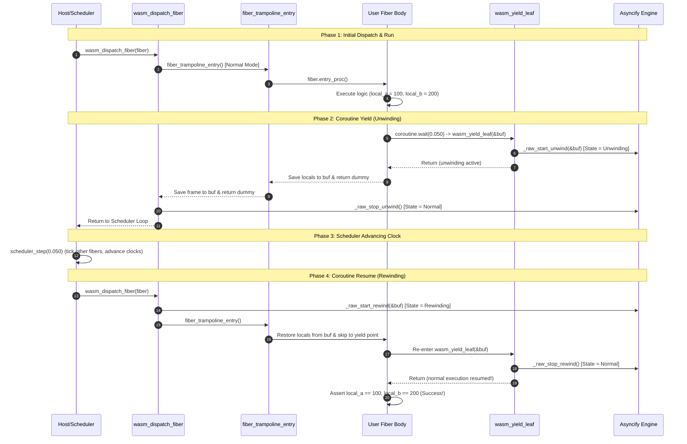

# WebAssembly Asyncify Architecture & Implementation (`TECH_WASM_ASYNCIFY.md`)

This technical specification details the architecture, execution model, low-level binary protocols, runtime boundary laws, and integration mechanics of the **WebAssembly (`js_wasm32`)** target in the **Odin Stackful Coroutine Engine**.

> [!NOTE]
> For native hardware context switching mechanics covering AMD64, ARM64, and RISC-V 64, see [`TECH_ASM.md`](./TECH_ASM.md). For high-level compiler inline assembly internals, see [`TECH_ODIN_INLINE_ASM_ANALYSIS.md`](./TECH_ODIN_INLINE_ASM_ANALYSIS.md).

> [!TIP]
> **Dedicated WebAssembly Documentation Suite**:
> For the modular 6-part WebAssembly documentation suite (including Dual-Stack linear memory analysis, the Zero-C Canvas adapter, and the WasmFX Stack-Switching roadmap), see **[`docs/wasm/`](../wasm/README.md)**.

---

## 1. Architectural Foundations & WebAssembly Execution Model

### 1.1 The WebAssembly Challenge: The Invisible Stack
Standard CPU architectures (x86-64, AArch64, RV64) operate under a von Neumann memory model with exposed register files and an accessible execution stack. Context switching on these architectures simply requires saving callee-saved registers to memory and swapping the stack pointer register (`%rsp`, `sp`).

WebAssembly, by contrast, operates under a strict **Harvard Architecture**:
1. **Separation of Code and Data**: The call stack, return addresses, and local variables are managed entirely by the host WebAssembly execution engine (V8, SpiderMonkey, Wasmtime).
2. **Opacity of the Execution Stack**: WebAssembly bytecode instructions (`call`, `return`, `br`) operate on an implicit, invisible activation frame stack. The linear memory (`WebAssembly.Memory`) contains only user heaps and buffers—it does not contain the activation frames or instruction pointers of executing functions.
3. **No Direct Stack Manipulation**: There is no `%rsp` or `sp` register in the WebAssembly instruction set, and no primitive exists to save or restore activation frames or jump arbitrarily between function execution contexts.

### 1.2 The Binaryen Asyncify Solution
To achieve stackful coroutines and fiber context switching in WebAssembly without requiring experimental non-standard Wasm extensions (such as WasmFX / Stack Switching Proposal, which is not widely available in browser and server runtimes), the Odin coroutine engine uses **Binaryen's Asyncify transformation pass** (`wasm-opt --asyncify`).

Asyncify transforms standard WebAssembly binaries through whole-module static analysis and instrumentation:
- Every function in the call graph capable of suspending is rewritten into a **state machine**.
- When unwinding (yielding), each active call frame serializes its local variables and return call-index into a designated linear memory buffer (`Asyncify_Buffer`) before returning early with dummy values.
- When rewinding (resuming), execution re-enters from the root dispatcher, restores local variables from the buffer, and uses a synthesized jump table to skip directly back to the suspension call site.

### 1.3 Pure Odin Architecture (Zero Emscripten, Zero POSIX)
Unlike traditional C/C++ coroutine ports targeting the web, this implementation requires **no Emscripten SDK**, no `libunwind`, no `setjmp`/`longjmp`, and no POSIX libc shims. It is implemented in **100% pure Odin**, communicating directly with the 4 fundamental Binaryen Asyncify intrinsics and interacting with standard JavaScript / WebAssembly runtimes via a minimal, self-contained runner ([`tools/run_wasm.js`](../../tools/run_wasm.js)).

---

## 2. Universal 7-Target Architectural Matrix

```
┌──────────────────────────────────────────────────────────────────────────────────────────────────────────┐
│                               UNIVERSAL 7-TARGET MULTI-ISA & WASM MATRIX                                │
├───────────────────┬──────────────────────────┬──────────────────────┬────────────────────────────────────┤
│ Architecture      │ Target Platform / OS     │ Context Switch Mode  │ Execution Context & Preservation   │
├───────────────────┼──────────────────────────┼──────────────────────┼────────────────────────────────────┤
│ 1. AMD64 (x86-64) │ Windows (x64)            │ Native #byte opcode  │ 240B Stack Frame (Win64 ABI)       │
│                   │ Linux / Darwin (AMD64)   │ Native #byte opcode  │  64B Stack Frame (SysV ABI)        │
│ 2. ARM64 (AArch64)│ macOS (Apple Silicon),   │ Native #byte opcode  │ 160B Stack Frame (AAPCS64 ABI)     │
│                   │ Linux ARM, Android, iOS  │                      │                                    │
│ 3. RISC-V 64      │ Linux RISC-V (RV64GC),   │ Native #byte opcode  │ 208B Stack Frame (LP64D ABI)       │
│                   │ VisionFive, SBCs         │                      │                                    │
│ 4. WebAssembly    │ Browsers, Node.js,       │ Binaryen Asyncify    │ Dynamically Unwound Frame Stack    │
│    (js_wasm32)    │ Cloudflare Workers, Wasm │ (State Machine IR)   │ (Stored in Fiber.asyncify_buf)     │
└───────────────────┴──────────────────────────┴──────────────────────┴────────────────────────────────────┘
```

---

## 3. Binaryen Asyncify Low-Level Protocols

### 3.1 The Global State Machine (`__asyncify_state`)
The Asyncify pass injects a 32-bit mutable global variable into the WebAssembly module:
```wasm
(global $__asyncify_state (mut i32) (i32.const 0))
```
The state machine has three orthogonal states:

| Value | State Constant | Description |
| :---: | :--- | :--- |
| `0` | `State::Normal` | Normal forward execution. Code runs with standard WebAssembly semantics. |
| `1` | `State::Unwinding` | Call stack unwinding in progress. Functions record local variables, serialize call indices, and return dummy values up the stack. |
| `2` | `State::Rewinding` | Call stack rewinding in progress. Functions skip preambles, pop call indices, restore local variables, and jump to the suspended call instruction. |

### 3.2 The Data Structure (`__asyncify_data`)
Asyncify requires a pointer to a two-word descriptor followed by raw linear storage for the frame records:
```wasm
(global $__asyncify_data (mut i32) (i32.const 0))
```
In Odin, this is laid out as [`Asyncify_Buffer`](../../types.odin):
```odin
Asyncify_Buffer :: struct {
    top:     u32,                             // Current byte offset / top of stack in storage
    end:     u32,                             // Maximum byte offset / boundary limit (for overflow check)
    storage: [ASYNCIFY_STORAGE_SIZE]byte,     // Frame serialization memory (default: 4096 bytes)
}
```
- **`top`**: During unwinding, Asyncify appends call indices and local variable data, advancing `top` upward. During rewinding, it pops data from `top`, decrementing it back toward the base.
- **`end`**: Asyncify checks `top <= end` upon concluding unwind/rewind. If the buffer is exceeded, it traps immediately with `unreachable`.

### 3.3 The Four Binaryen Asyncify Intrinsics
The WebAssembly runtime communicates with Asyncify via 4 foreign procedures:
```odin
foreign import asyncify "asyncify"

@(default_calling_convention = "c")
foreign asyncify {
    @(link_name = "start_unwind")
    _raw_start_unwind :: proc(buf: rawptr) ---
    @(link_name = "stop_unwind")
    _raw_stop_unwind  :: proc() ---
    @(link_name = "start_rewind")
    _raw_start_rewind :: proc(buf: rawptr) ---
    @(link_name = "stop_rewind")
    _raw_stop_rewind  :: proc() ---
}
```
During static analysis, `wasm-opt` intercepts any foreign imports from module `"asyncify"` and replaces them with direct internal calls to the synthetic state-manipulation procedures created by the pass.

---

## 4. The Runtime Boundary Law & Leaf Protocol Discovery

### 4.1 Binaryen Call-Graph Classification
A critical design requirement of Asyncify is that the **runtime support code** (the scheduler that initiates and terminates unwinding/rewinding) must **NOT** be instrumented. If the scheduler were instrumented, the unwind would not stop at the scheduler—it would unwind completely out of the WebAssembly instance into JavaScript.

In `Asyncify.cpp` (Binaryen AST compiler pass), functions are classified into two structural categories:

```
                  ┌────────────────────────────────────────────────────────┐
                  │                 Binaryen Classification                │
                  └───────────────────────────┬────────────────────────────┘
                                              │
                    ┌─────────────────────────┴─────────────────────────┐
                    ▼                                                   ▼
       [isBottomMostRuntime]                               [isTopMostRuntime]
       Calls: stop_unwind, start_rewind                    Calls: start_unwind, stop_rewind
       Role : Scheduler / Dispatcher Boundary              Role : Coroutine Leaf Yield Boundary
       Trait: NOT instrumented; callers NOT instrumented   Trait: NOT instrumented; callers ARE instrumented
```

1. **`isBottomMostRuntime`** (The Host / Scheduler Boundary):
   - Defined as any function that directly calls `stop_unwind` or `start_rewind`.
   - **Behavior**: Binaryen excludes this function from instrumentation (`canChangeState = false`). It does not unwind or rewind. Callers of this function are also not instrumented.
   - **Engine Role**: [`wasm_dispatch_fiber`](../../asm_wasm32.odin).
2. **`isTopMostRuntime`** (The Coroutine Leaf Yield Boundary):
   - Defined as any function that directly calls `start_unwind` or `stop_rewind`.
   - **Behavior**: Binaryen excludes the function itself from instrumentation (`!info.isTopMostRuntime`), but marks it as changing state (`canChangeState = true`). **Crucially, all functions that call it ARE instrumented!**
   - **Engine Role**: [`wasm_yield_leaf`](../../asm_wasm32.odin).

### 4.2 The Two Critical Pitfalls of Naive Implementations

During development of the WebAssembly backend, two subtle traps were uncovered that caused `RuntimeError: unreachable` or 0-byte buffer saves:

#### Pitfall 1: Sequential Execution Trapping (The 0-Byte Buffer Bug)
If a yield function is written naively as:
```odin
// BROKEN PATTERN:
wasm_yield :: proc(f: ^Fiber) {
    _raw_start_unwind(&f.asyncify_buf) // Sets state = 1 (Unwinding)
    _raw_stop_rewind()                 // Unconditionally sets state = 0 (Normal)!
}
```
Because `wasm_yield` is a leaf function, WebAssembly executes both lines in immediate sequence before unwinding can bubble to callers. `_raw_stop_rewind()` unconditionally resets `__asyncify_state = 0 (Normal)`. When the function returns, the caller inspects `__asyncify_state`, sees `0`, and assumes normal execution! As a result:
- The stack frame is never serialized.
- 0 bytes are written to `asyncify_buf`.
- Upon subsequent rewind, Asyncify attempts to pop call indices from an empty buffer and crashes with `RuntimeError: unreachable`.

#### Pitfall 2: Preamble Skipping During Rewind
When Asyncify rewinds a function, it **does not re-execute code from the top of the function**. It inspects the popped call index and jumps directly forward to the call site that previously unwound.

If conditional logic (`if is_rewinding`) is placed in an instrumented caller rather than the uninstrumented leaf:
```odin
// BROKEN PATTERN:
coro_yield :: proc() {
    if g_is_rewinding { // SKIPPED BY ASYNCIFY DURING REWIND!
        stop_rewind()
        return
    }
    do_unwind()         // Asyncify jumps straight here and calls do_unwind again!
}
```
During rewind, Asyncify bypasses the `if g_is_rewinding` block entirely and jumps directly to `do_unwind()`, calling `start_unwind()` while in the middle of a rewind! This immediately corrupts the runtime state.

### 4.3 The Solution: The Symmetric Leaf Yield Protocol

The correct, production architecture isolates state transitions inside a single, uninstrumented leaf function ([`asm_wasm32.odin`](../../asm_wasm32.odin)):

```odin
// Package-level execution state on WebAssembly
g_wasm_in_fiber:      bool   = false
g_wasm_current_fiber: ^Fiber = nil
g_wasm_is_rewinding:  bool   = false

// Leaf yield function: called by an active fiber to yield execution back to the host/scheduler.
// Because it calls both _raw_start_unwind and _raw_stop_rewind, Binaryen recognizes it
// as top-most runtime (isTopMostRuntime) and does NOT instrument it.
wasm_yield_leaf :: #force_no_inline proc(buf: ^Asyncify_Buffer) {
    if g_wasm_is_rewinding {
        g_wasm_is_rewinding = false
        _raw_stop_rewind()
        return
    }

    buf.top = u32(uintptr(&buf.storage[0]))
    buf.end = u32(uintptr(&buf.storage[0]) + ASYNCIFY_STORAGE_SIZE)
    _raw_start_unwind(buf)
}
```

#### How Symmetry Operates:
1. **Unwind Phase (Yield)**:
   - `g_wasm_is_rewinding` is `false`.
   - `wasm_yield_leaf` resets `buf.top` to storage base and calls `_raw_start_unwind(buf)`.
   - `__asyncify_state` becomes `1` (`State::Unwinding`).
   - `wasm_yield_leaf` returns to its caller ([`fiber_context_switch`](../../asm_wasm32.odin)).
   - All callers above `fiber_context_switch` (e.g. `coroutine.wait`, user fiber body, `fiber_trampoline_entry`) are instrumented. They serialize their locals and call indices into `buf`, unwinding up to `wasm_dispatch_fiber`.
   - `wasm_dispatch_fiber` calls `_raw_stop_unwind()`, concluding the unwind and returning cleanly to the scheduler.

2. **Rewind Phase (Resumption)**:
   - Scheduler decides to wake the fiber. It calls `wasm_dispatch_fiber(f)`.
   - `wasm_dispatch_fiber` sets `g_wasm_is_rewinding = true` and calls `_raw_start_rewind(&f.asyncify_buf)`.
   - `__asyncify_state` becomes `2` (`State::Rewinding`).
   - `wasm_dispatch_fiber` calls `fiber_trampoline_entry()`.
   - Every instrumented function pops its call index, restores its local variables, and executes the recorded child call.
   - Execution traverses down the exact call stack until reaching the call to `wasm_yield_leaf`.
   - Execution enters `wasm_yield_leaf`.
   - `g_wasm_is_rewinding` is `true`! It clears `g_wasm_is_rewinding = false` and calls `_raw_stop_rewind()`.
   - `__asyncify_state` transitions from `2` (`Rewinding`) to `0` (`Normal`).
   - `wasm_yield_leaf` returns to `fiber_context_switch`.
   - `fiber_context_switch` sees state is `Normal (0)`—it does not unwind! It returns cleanly to `coroutine.wait`.
   - Normal forward execution resumes seamlessly with all local variables preserved.

---

## 5. Memory Layout & Fiber Synthesis

### 5.1 Fiber Struct Memory Footprint
On `js_wasm32`, `Fiber` contains embedded fields specifically for Asyncify state:

```odin
Fiber :: struct {
    // Standard Header & Context (Common across all 7 ISAs)
    handle:           Fiber_Handle,
    pool_index:       u16,
    generation:       u16,
    saved_sp:         rawptr,          // On wasm32: points to fiber self (^Fiber)
    status:           Fiber_Status,
    scope:            ^Fiber_Scope,
    sched:            ^Scheduler,

    // WebAssembly Asyncify Execution State (wasm32 only)
    wasm_started:     bool,
    asyncify_buf:     Asyncify_Buffer, // 4,104 bytes embedded inline

    // Structured Concurrency & Synchronization
    parent:           ^Fiber,
    first_child:      ^Fiber,
    // ...
}
```

### 5.2 Initial Stack Synthesis on Wasm32
In [`pool.odin`](../../pool.odin#L470), stack synthesis for `.wasm32` differs from native assembly:

```odin
fiber_synthesize_initial_stack :: proc(fiber: ^Fiber) {
    when ODIN_ARCH == .amd64 {
        // Synthesize x86-64 RSP frame with trampoline address
    } else when ODIN_ARCH == .arm64 {
        // Synthesize AArch64 AAPCS64 frame with LR/x30 trampoline
    } else when ODIN_ARCH == .riscv64 {
        // Synthesize RISC-V LP64D frame with RA trampoline
    } else when ODIN_ARCH == .wasm32 {
        fiber.wasm_started = false
        fiber.asyncify_buf.top = u32(uintptr(&fiber.asyncify_buf.storage[0]))
        fiber.asyncify_buf.end = u32(uintptr(&fiber.asyncify_buf.storage[0]) + ASYNCIFY_STORAGE_SIZE)
        fiber.saved_sp = rawptr(fiber)
    }
}
```
- **`saved_sp`**: Because WebAssembly cannot store a physical hardware stack pointer, `saved_sp` stores a direct pointer to the `Fiber` itself (`rawptr(fiber)`). This allows the scheduler to pass `f.saved_sp` to `fiber_context_switch` symmetrically with native architectures.
- **`wasm_started`**: Initialized to `false`. On the first dispatch, `wasm_dispatch_fiber` invokes `fiber_trampoline_entry()` directly without rewinding. On subsequent dispatches, it activates rewinding.

### 5.3 Natural Termination & Trampoline Entry
When a fiber naturally completes its user procedure, execution reaches the end of [`fiber_trampoline_entry`](../../pool.odin#L482):
```odin
    // 5. Notify completion to coordinator & parent
    fiber_on_finish(fiber)

    // 6. Final yield to scheduler
    fiber_yield_final(fiber)
```
In [`fiber_yield_final`](../../pool.odin#L529):
```odin
fiber_yield_final :: proc "c" (fiber: ^Fiber) {
    when ODIN_ARCH == .wasm32 {
        return // Natural return exits trampoline back to wasm_dispatch_fiber
    } else {
        if fiber.sched != nil {
            fiber_context_switch(&fiber.saved_sp, fiber.sched.scheduler_sp)
        }
    }
}
```
On native platforms, `fiber_yield_final` performs a context switch to switch away from the dying stack. On WebAssembly, the fiber simply returns from `fiber_trampoline_entry()` into `wasm_dispatch_fiber()`, which resets `g_wasm_in_fiber = false` and returns control to the scheduler.

---

## 6. End-to-End Execution Sequence



---

## 7. Single-File Amalgamation & Architecture Filtering

### 7.1 The Odin Parser Syntax Constraint
A critical compiler constraint discovered during multi-target verification is that **Odin syntax-checks `asm(...)` templates during parsing, before semantic analysis (`when`) is evaluated**:
```
Syntax Error: asm templates are currently only supported on -target:*_amd64 or -target:*_riscv64 or -target:*_arm64
    fiber_context_switch :: asm(from_rsp: ^rawptr, to_rsp: rawptr) [ ... ]
```
Even if an `asm(...)` block is wrapped in `when ODIN_ARCH == .amd64 { ... }`, compiling that file for `js_wasm32` causes a compiler syntax error because the WebAssembly backend lacks an inline assembler.

In the modular repository layout, Odin avoids this issue through **automatic filename architecture filtering**:
- Files named `*_amd64.odin`, `*_arm64.odin`, and `*_riscv64.odin` are completely excluded from the parse tree when targeting `js_wasm32`.
- `asm_wasm32.odin` is included only when targeting WebAssembly.

### 7.2 The Dual Amalgamation Architecture
When generating single-file amalgamated distributions via [`tools/amalgamate.py`](../../tools/amalgamate.py), merging native assembly and WebAssembly into a single file causes `odin check -target:js_wasm32` to fail on the native inline assembly blocks.

To solve this cleanly for downstream users and package managers, `tools/amalgamate.py` produces **two specialized standalone builds** in `dist/`:

1. **[`dist/coroutine.odin`](../../dist/coroutine.odin)** (Multi-ISA Native Build):
   - Combines `config.odin`, `types.odin`, `asm_amd64.odin`, `asm_arm64.odin`, `asm_riscv64.odin`, `pool.odin`, `scheduler.odin`, and `api.odin`.
   - Prepended with `#+build !js`.
   - Verified across `windows_amd64`, `linux_amd64`, `darwin_arm64`, `linux_arm64`, and `linux_riscv64`.
2. **[`dist/coroutine_wasm32.odin`](../../dist/coroutine_wasm32.odin)** (WebAssembly Build):
   - Combines `config.odin`, `types.odin`, `asm_wasm32.odin`, `pool.odin`, `scheduler.odin`, and `api.odin`.
   - Contains zero `asm(...)` blocks; 100% pure high-level Odin.
   - Prepended with `#+build wasm32`.
   - Verified across `js_wasm32`.

When a downstream project vendors the `dist/` folder, Odin automatically selects [`dist/coroutine.odin`](../../dist/coroutine.odin) on desktop/server/mobile platforms and [`dist/coroutine_wasm32.odin`](../../dist/coroutine_wasm32.odin) on WebAssembly with zero manual configuration.

---

## 8. Test Verification Matrix & Tooling

### 8.1 The 8-Suite WebAssembly Test Matrix
The WebAssembly backend is verified by [`examples/wasm_test/main.odin`](../../examples/wasm_test/main.odin), exercising every engine primitive under Asyncify transformation:

| Test ID | Test Suite | Verified Subsystems & Behavioral Invariants | Status |
| :---: | :--- | :--- | :---: |
| **Test 1** | Minimal Fiber Spawn & Natural Finish | Fiber pool acquisition, trampoline entry, context establishment, status transitions (`Running` -> `Completed`), natural return. | **PASS** |
| **Test 2** | Local Variables Preserved Across Yields | Stack preservation, local variables (`local_a`, `local_b`) retained across multiple `coroutine.wait()` suspension cycles. | **PASS** |
| **Test 3** | Concurrent Fiber Interleaving | Multi-fiber ready queue scheduling, cooperative round-robin execution interleaving without cross-talk. | **PASS** |
| **Test 4** | Structured Concurrency: `sync()` | Intrusive branch coordination, child fiber spawning, hierarchical parent suspension, deterministic multi-branch completion. | **PASS** |
| **Test 5** | Structured Concurrency: `race()` | First-to-complete winner resolution, automatic cancellation and pruning of losing branches. | **PASS** |
| **Test 6** | CSP Channel Rendezvous | Unbuffered synchronous communication, sender-receiver blocking synchronization, zero-copy value transfer. | **PASS** |
| **Test 7** | Multi-Domain Clocks & Time Scaling | Simulated time domain (`sim_time`), variable time scaling (`time_scale = 0.5x`), real-time clock domain isolation. | **PASS** |
| **Test 8** | Structured `Fiber_Scope` Abort | Group cancellation, intrusive doubly-linked scope membership pruning, cancellation of sleeping fibers. | **PASS** |

### 8.2 Automation Commands ([`build.ps1`](../../build.ps1))

All WebAssembly tasks are fully integrated into the project's build automation:

```powershell
# Cross-check WebAssembly compilation
.\build.ps1 check-wasm

# Cross-check all 7 architectures (AMD64, ARM64, RISC-V 64, WebAssembly)
.\build.ps1 check-all

# Build WebAssembly test binary and post-process with wasm-opt --asyncify
.\build.ps1 wasm

# Run full WebAssembly test suite in headless Node.js
.\build.ps1 test-wasm

# Generate and verify amalgamated distributions (dist/coroutine.odin & dist/coroutine_wasm32.odin)
.\build.ps1 amalgamate
.\build.ps1 test-dist
```
