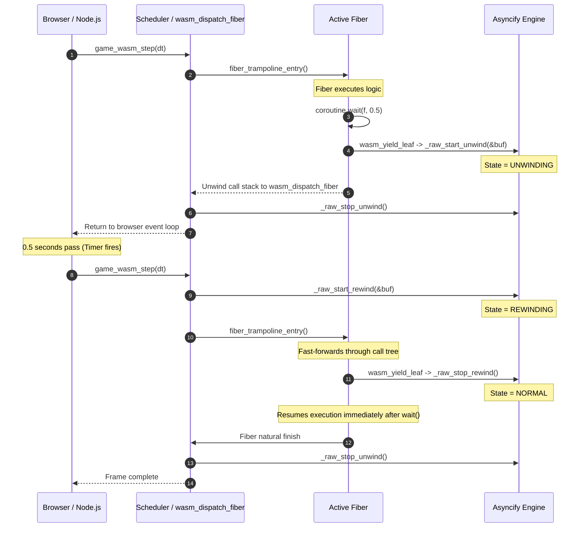

# WebAssembly Architecture: Binaryen Asyncify Integration

This document provides a deep technical breakdown of the WebAssembly (`js_wasm32`) coroutine execution model implemented using **Binaryen Asyncify**. It details how call graphs are instrumented, the precise mechanics of the **Leaf Unwind/Rewind Protocol**, and how fibers interleave with the browser event loop.

---

## 1. Why Asyncify? The WebAssembly 1.0 Continuation Gap

On native architectures (AMD64, ARM64, RISC-V 64), CPU registers and hardware stack pointers (`%rsp` / `sp`) can be swapped directly via machine instructions. WebAssembly 1.0, however, executes on a sandboxed virtual machine with a structured call stack that cannot be observed, modified, or bifurcated by running WebAssembly instructions.

To run stackful coroutines on WebAssembly today without waiting for future browser VM proposals, we employ **Binaryen Asyncify** (`wasm-opt --asyncify`). Asyncify transforms WebAssembly bytecode by injecting synthetic state machines into every function in the call graph. When a yield is requested, Asyncify:
1. **Unwinds** the execution call stack frame-by-frame back to a designated boundary, saving local variables and loop counters into an in-memory buffer.
2. **Rewinds** the call stack upon resumption, fast-forwarding through control flow structures directly to the exact instruction following the yield call.

---

## 2. The Asyncify Data Structures (`types.odin`)

Each `Fiber` allocated in the `Fiber_Pool` carries its own dedicated Asyncify state (`4096` bytes on `wasm32`, `8` bytes stub on native):

```odin
// types.odin
when ODIN_ARCH == .wasm32 {
    ASYNCIFY_STORAGE_SIZE :: 4096
} else {
    ASYNCIFY_STORAGE_SIZE :: 8
}

Asyncify_Buffer :: struct {
    top:     u32,
    end:     u32,
    storage: [ASYNCIFY_STORAGE_SIZE]byte,
}

Fiber :: struct {
    // ...
    wasm_started: bool,
    asyncify_buf: Asyncify_Buffer,
    // ...
}
```

By convention in the Binaryen runtime:
- `top` (offset `+0`): Current write/read cursor into `storage`, initialized to `uintptr(&buf.storage[0])` before each unwind.
- `end` (offset `+4`): Upper boundary of `storage` (`uintptr(&buf.storage[0]) + ASYNCIFY_STORAGE_SIZE`).
- `storage` (offset `+8`): Inline serialization buffer holding saved Wasm VM locals and call-frame state for that fiber.

---

## 3. The Leaf Unwind/Rewind Protocol

In typical Asyncify usage from C/C++ (Emscripten), `asyncify.start_unwind` is invoked from host JavaScript or an uninstrumented foreign function. In our Odin native runtime, however, fibers yield from deep inside pure Odin code (`coroutine.wait`, `coroutine.yield`, or `coroutine.ticker_wait`).

### The Architectural Challenge
Binaryen's Asyncify pass automatically classifies functions based on which `asyncify.*` imports they invoke:
- Calling **both** `start_unwind` and `stop_rewind` marks a procedure as **top-most runtime** (leaf boundary, left uninstrumented).
- Calling **both** `start_rewind` and `stop_unwind` marks a procedure as **bottom-most runtime** (dispatcher boundary, left uninstrumented).

If the leaf procedure does not stop the rewind state upon re-entry, execution traps with:
```
RuntimeError: unreachable (or asyncify state corrupted)
```

### The Solution: The Symmetric Leaf Protocol in `asm_wasm32.odin`
To achieve clean suspension and resumption from arbitrary nested procedures without modifying `scheduler.odin`, `asm_wasm32.odin` implements `fiber_context_switch` using two uninstrumented boundary procedures (`wasm_yield_leaf` and `wasm_dispatch_fiber`):

```odin
// asm_wasm32.odin (when ODIN_ARCH == .wasm32)
wasm_yield_leaf :: #force_no_inline proc(buf: ^Asyncify_Buffer) {
    if g_wasm_is_rewinding {
        g_wasm_is_rewinding = false
        _raw_stop_rewind()
        return
    }

    buf.top = u32(uintptr(&buf.storage[0]))
    buf.end = u32(uintptr(&buf.storage[0]) + ASYNCIFY_STORAGE_SIZE)
    _raw_start_unwind(buf)
}

fiber_context_switch :: proc(from_sp: ^rawptr, to_sp: rawptr) {
    if !g_wasm_in_fiber {
        f := (^Fiber)(to_sp)
        if f == nil && g_wasm_current_fiber != nil {
            f = g_wasm_current_fiber
        }
        if f == nil do return

        g_wasm_in_fiber = true
        wasm_dispatch_fiber(f)
        g_wasm_in_fiber = false
    } else {
        f := g_wasm_current_fiber
        if f == nil do return

        wasm_yield_leaf(&f.asyncify_buf)
    }
}
```

```text
           YIELD PHASE                             REWIND PHASE
    ┌─────────────────────────┐             ┌─────────────────────────┐
    │     User Fiber Code     │             │     User Fiber Code     │
    └───────────┬─────────────┘             └───────────▲─────────────┘
                │ wait() / yield()                      │ resumes!
    ┌───────────▼─────────────┐             ┌───────────┴─────────────┐
    │     wasm_yield_leaf     │             │     wasm_yield_leaf     │
    │   _raw_start_unwind     │             │    _raw_stop_rewind     │
    └───────────┬─────────────┘             └───────────▲─────────────┘
                │ unwinds stack                         │ fast-forwards
    ┌───────────▼─────────────┐             ┌───────────┴─────────────┐
    │   wasm_dispatch_fiber   │ ──next tick─►   wasm_dispatch_fiber   │
    │    _raw_stop_unwind     │             │   _raw_start_rewind     │
    └─────────────────────────┘             └─────────────────────────┘
```

---

## 4. Execution Lifecycle & Scheduler Dispatch

Because WebAssembly is single-threaded, concurrency is purely cooperative and interleaved with the host JavaScript run-loop.

### Dispatching Fresh vs. Resumed Fibers
When `scheduler_run` calls `fiber_context_switch(&sched.scheduler_sp, f.saved_sp)`, `wasm_dispatch_fiber` checks `f.wasm_started`:

```odin
// asm_wasm32.odin
wasm_dispatch_fiber :: proc(f: ^Fiber) {
    g_wasm_current_fiber = f
    if !f.wasm_started {
        f.wasm_started = true
        fiber_trampoline_entry()
    } else {
        g_wasm_is_rewinding = true
        _raw_start_rewind(&f.asyncify_buf)
        fiber_trampoline_entry()
    }
    _raw_stop_unwind()
}
```

### Complete Yield/Resume Sequence Diagram



---

## 5. Performance & Overhead Characteristics

### Context Switch Latency
- **Native Context Switch**: ~16 ns (fixed register push/pop).
- **Asyncify Context Switch**: ~120–350 ns depending on call depth.
  - The latency is proportional to the number of active call frames being traversed during unwind and rewind.
  - For typical game coroutines (call depth 2–5), this corresponds to **over 2,500,000 switches per second** per core on modern browser engines.

### Binary Size Impact
Running `wasm-opt --asyncify` adds approximately **10% to 15%** to the final WebAssembly binary size. The optimizer generates auxiliary state variables, dispatch tables, and spill/reload instructions for each instrumented function.

To keep binary size and dispatch overhead minimal:
1. Only procedures reachable from fiber entrypoints are instrumented.
2. Inlined leaf utility functions without yield points are marked `#no_inline` or kept leaf-pure to prevent state machine proliferation.

---

## 6. Cross-Platform Binaryen Installation

To run `wasm-opt --asyncify`, install Binaryen via any of the supported cross-platform methods:

- **PowerShell Core (`pwsh`)**: `.\tools\download_binaryen.ps1` (Windows, Linux, macOS)
- **Python 3**: `python tools/download_binaryen.py` (Windows, Linux, macOS)
- **Homebrew (macOS)**: `brew install binaryen`
- **APT (Ubuntu/Debian)**: `sudo apt install binaryen`
- **Pacman (Arch Linux)**: `sudo pacman -S binaryen`
